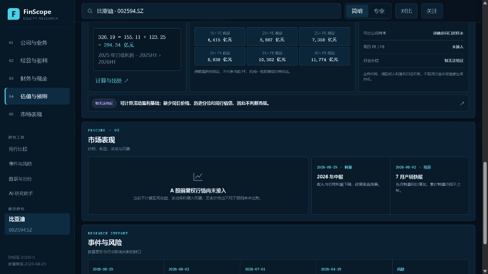

# FinScope

FinScope 是一个可操作的个股研究工作台。当前公开版本以比亚迪为完整样例，把公司与业务、经营与盈利、财务与现金、估值与预期、市场表现、同行位置、事件与风险组织在同一条研究链上。

- Web 产品：[stock-evidence-lab-midea.violet-lotus-6432.chatgpt.site](https://stock-evidence-lab-midea.violet-lotus-6432.chatgpt.site)
- 源代码：[github.com/hwerhfhwf/stock-evidence-lab](https://github.com/hwerhfhwf/stock-evidence-lab)



## 用户可以获得什么

- 先识别公司如何取得收入，再连接收入、利润和经营现金的变化。
- 在 2025 全年、2026Q1、2026H1 之间切换，保持同一报告期比较。
- 查看利润变化分解、现金结构、流动性和滚动归母利润计算。
- 区分客观事实、分析推断、方向分化和暂时无法验证的信息。
- 点击具体判断，查看与之对应的原值、报告期、口径、页码和原报告链接。
- 输入研究问题，只改变研究维度的优先级，不改写或隐藏基础事实。

产品不输出综合评分、确定性涨跌预测或买卖建议。行情、同日估值和同行数据未接入时，缺口直接显示在受影响模块，不用示意数字替代。

## 数据与口径

默认样例使用比亚迪公开披露的 2025 年报、2026 年一季报、2026 年中报摘要及 2026 年 6—7 月产销快报。结构化快照位于 `ui/finscope-data.js`；每条可验证判断通过 `sourceId`、页码、期次和原值连接到来源。

关键确定性计算包括：

```text
TTM 归母利润 = 2025 年归母利润 − 2025H1 归母利润 + 2026H1 归母利润
               = 326.19 − 155.11 + 123.25
               = 294.34 亿元
```

简明和专业模式共用同一份事实与判断；专业模式只增加原值表和口径细节。

## 本地运行

需要 Node.js 18+。默认比亚迪研究快照不需要密钥：

```powershell
npm test
npm run build
npm run serve
```

打开 `http://127.0.0.1:4173/`。

如需调用扶摇实时接口，在服务端环境设置：

```powershell
$env:FUYAO_API_KEY = '仅在本地或部署平台设置'
```

密钥只由 Worker 服务端读取，不进入浏览器代码、构建产物或接口响应。

## 代码结构

- `ui/finscope-data.js`：比亚迪披露快照、派生指标、证据和演示 bundle。
- `ui/diagnosis-model.js`：问题路由、维度优先级、命题和证据模型。
- `ui/index.html`、`ui/app.js`、`ui/styles.css`：研究工作台、图表、交互和响应式布局。
- `worker/`：同源静态发布、扶摇适配器和研究数据聚合。
- `scripts/build-worker.mjs`：从 `ui/` 生成 `dist/` 与 Worker 发布物。
- `tests/`：数据口径、计算、追溯、缺失状态、接口安全、UI 与构建一致性契约。

## 已知边界

- 默认公开版本没有 A 股前复权价格序列，因此不计算收益、波动率和最大回撤。
- 同日价格、历史估值分位和同口径同行样本未接入，因此不判断估值高低或行业排名。
- 合并财报不能单独识别价格、销量和产品结构对收入的贡献。
- 产销快报与定期报告是不同披露口径，事件卡保留原披露日期和来源。

更多记录见 [AI_USAGE_AND_VALIDATION.md](AI_USAGE_AND_VALIDATION.md) 和 [TESTING.md](TESTING.md)。
