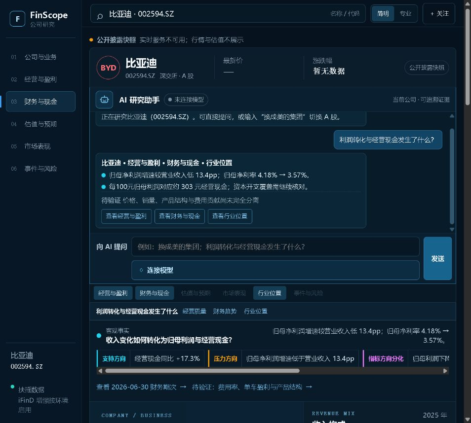

# FinScope

AI Native A 股公司研究工作台。以数据关系和证据链呈现公司状态，不输出“好 / 坏”标签、涨跌预测或买卖建议。

[在线产品](https://stock-evidence-lab-midea.violet-lotus-6432.chatgpt.site) · [公共源码](https://github.com/hwerhfhwf/stock-evidence-lab)

## 产品

| 能力 | 结果 |
| --- | --- |
| A 股换股 | 搜索名称或代码，重建公司、财务、估值、行情和证据；不沿用上一家公司内容。 |
| 关系可视化 | 串联收入、利润、现金与资本结构；经营和行情图支持区间切换。 |
| 证据表达 | 区分事实、推断、未验证；标注支持、压力、方向分化和未知。 |
| 继续研究 | 从结论进入财务期次、行情区间、同行比较、待验证问题和原始来源。 |
| AI 研究助手 | 可换股、回答自定义问题并生成研究草稿；确定性数值仍由程序计算。 |




## AI Native 分工

| 程序负责 | 模型负责 |
| --- | --- |
| 拉取数据、统一口径、计算指标、校验证据与图表 | 选择研究维度、组织证据关系、生成受约束的解读草稿 |

模型只能引用标准化 `SourcePackage` 中的字段。`ResearchClaim` 与 `ChartSpec` 校验失败时，保留默认研究，不替换数值。

- 不连接模型：换股、确定性分析、结构化证据和钻取均可使用。
- 连接模型：点击“连接模型”，填写兼容 OpenAI 的端点、模型与临时 API Key；真实请求验证通过后生效。
- 密钥：仅在当前请求内存中转发，不写入浏览器存储、仓库或日志。

默认预置 Gemini 的 [OpenAI compatibility](https://ai.google.dev/gemini-api/docs/openai/) 端点，也支持其他兼容接口。

## 数据与可信边界

| 数据源 | 用途 |
| --- | --- |
| **扶摇主数据** | A 股搜索、行情、K 线、财务、指标和最新估值。 |
| 东方财富 F10 | 公司概况与行业文本；与扶摇财务字段分开标注。 |
| **iFinD 可选增强** | 新闻、政策、宏观和跨市场语境。 |
| 公开披露 | 分部收入等接口未覆盖字段。 |

浏览器只访问同源 `/api/search` 与 `/api/research`。数据缺失、过期、冲突或调用失败时执行**模块级降级**：保留成功模块，失败位置显示原因；实时服务不可用时明确标注“**公开披露快照**”。

## 本地运行

需要 Node.js 18+：

```powershell
npm test
npm run build
npm run serve
```

打开 `http://127.0.0.1:4173/`。启用扶摇实时数据：

```powershell
$env:FUYAO_API_KEY = '仅在本地会话或部署平台设置'
npm run serve
```

`FUYAO_API_KEY` 仅由 Worker 读取。iFinD 配置同样留在服务端。

## 代码结构

| 层级 | 目录 | 职责 |
| --- | --- | --- |
| 数据服务 | `worker/` | 数据接入、输入校验、密钥隔离和模块降级。 |
| 研究内核 | `ui/research-view.js`、`ui/research-protocol.js` | 口径统一、确定性计算和证据约束。 |
| 产品交互 | `ui/app.js`、`ui/assistant-intent.js`、`ui/chart-exploration.js` | 换股、图表、钻取和 AI 研究。 |
| 质量保障 | `tests/` | 计算、来源、缺失状态、接口、UI 和发布验证。 |

详见 [数据架构](docs/live-data-architecture.md) 与 [交付说明](docs/product-handoff.md)。

## 当前边界

- 扶摇仅提供最新估值快照，暂不计算历史估值分位。
- 同日同口径同行样本未完成，不生成行业排名。
- iFinD 未配置时，不生成新闻、政策或宏观影响判断。
- 合并财报不能单独识别价格、销量和产品结构的贡献。

FinScope 仅作研究辅助，不构成投资建议。
